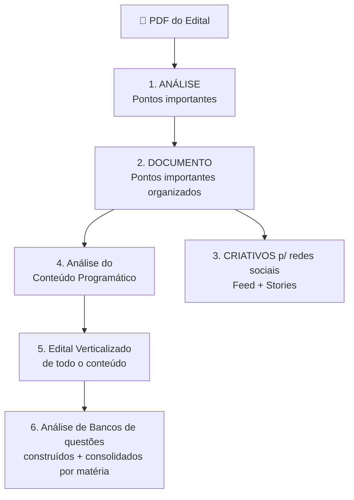

# Fluxo — Programa de Análise de Edital

Transcrição do esboço original + diagrama.

## Diagrama

## Descrição de cada etapa

1. **PDF do Edital** — entrada. O usuário fornece o arquivo do edital.
2. **Análise / Pontos importantes** — leitura do edital e extração dos dados-chave:
   banca, órgão, cargos, vagas, remuneração, taxa de inscrição, escolaridade,
   datas (inscrição, prova), requisitos.
3. **Documento** — os pontos importantes organizados num documento legível
   (Markdown), pronto para consulta e para virar insumo das demais etapas.
4. **Criativos para redes sociais** (ramo lateral) — a partir dos pontos importantes,
   gerar textos/roteiros de **Feed** e **Stories** para divulgação.
5. **Análise do Conteúdo Programático** — identificar as disciplinas e os tópicos
   cobrados no edital.
6. **Edital Verticalizado** — transformar o conteúdo programático em uma estrutura
   hierárquica (disciplina → tópico → subtópico), com espaço para marcar progresso.
7. **Análise de Bancos de questões** — consolidar e analisar questões por matéria,
   ligadas ao edital verticalizado.
